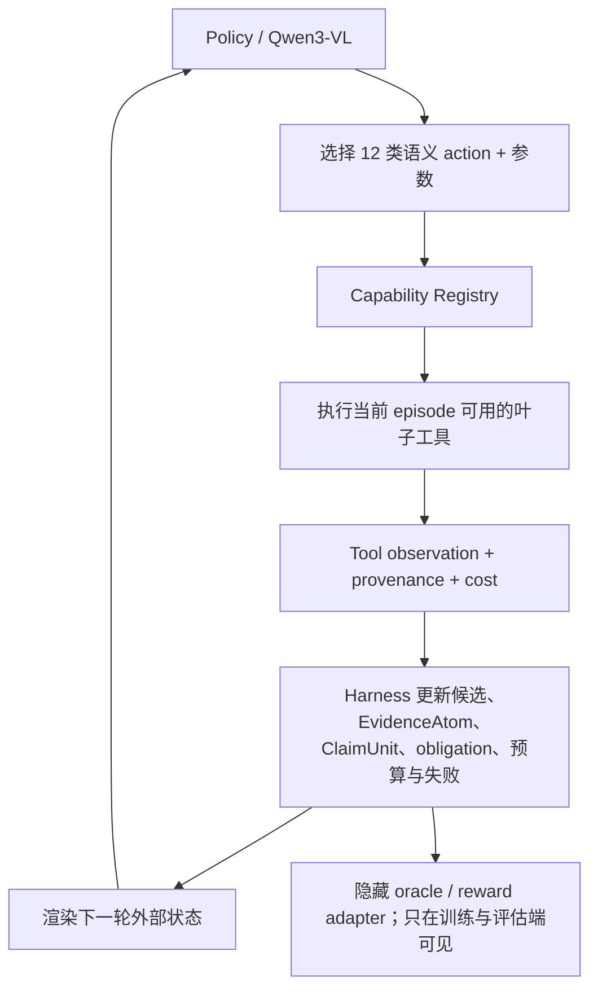

# ECSO 多轮视频取证环境：数据集全集、能力矩阵与工具箱设计（2026-08-16）

> 2026-08-17 收敛说明：本文件保留数据集全集和工具候选清单；运行时动作空间已进一步收敛为“6 个证据义务分支 → 12 个中层动作 → 工具叶子”。以 [ECSO_HIERARCHICAL_ACTION_TREE_20260817.md](ECSO_HIERARCHICAL_ACTION_TREE_20260817.md) 为准。

## 0. 结论先行

原来的 7 个宏动作不应该直接扩成几十个同级动作。更稳妥、也更接近 Harness-1 与 VideoSearcher 的做法是：

1. 保留一组稳定的**语义宏动作**，由策略模型决定下一步做什么；
2. 在每个宏动作下挂接多个**可执行工具适配器**，工具数可以随数据集增加；
3. Harness 维护候选源、证据原子、claim、未满足义务、预算与失败记录；
4. 不同数据集通过 adapter 决定可见输入、可用工具、隐藏 oracle、奖励与最终输出；
5. 训练样本必须是“模型选 action/tool → 环境真实执行 → 返回 observation → 模型再决策”的多轮轨迹，而不是预先写好的静态步骤标签。

建议从 7 个宏动作扩为下面 12 个稳定动作：

`observe_media`、`localize`、`extract_clue`、`search`、`inspect_candidate`、`verify_source`、`compare`、`curate_evidence`、`edit_claim`、`verify_claim`、`replan`、`stop`。

这 12 个动作不是固定流水线，可以循环、回退和跳过。真正的数据集差异由其下 50 余个可注册叶子能力和 dataset adapter 吸收。

---

## 1. 研究边界：不是“一个模型原样做完所有 benchmark”

这里的“覆盖全部数据集”应理解为：一个统一环境能够承载这些数据集，并让它们分别监督取证链中的不同能力，而不是强迫所有数据集输出同一种 misinformation label。

统一的最小对象是：

- **EvidenceAtom**：一个工具执行后得到的、带来源与定位信息的观测；
- **EvidenceObligation**：当前结论还缺什么证据；
- **ClaimUnit**：结论、限定条件、支持证据、反证和置信度；
- **ActionRecord**：模型调用了什么工具、参数是什么、环境返回了什么；
- **EpisodeState**：候选源、已检查区域、证据、claims、预算、失败与下一步缺口。

不同任务只改变 obligation 和终局：

| Episode 模式 | 典型数据集 | 终局对象 |
|---|---|---|
| `open_world_search` | EVID-Bench、GroundLie360、VideoDR、VideoSearch-QA | 有来源引用的 ClaimUnit / answer |
| `closed_corpus_search` | VCDB、VCSL、FIVR、MultiVENT | 源视频或候选排序 + 匹配区间 |
| `paired_source_compare` | VideoSham、VidDiffBench、StepDiff | 差异 ClaimUnit + 双边定位 |
| `localize_and_reason` | QVHighlights、Ego4D-NLQ、ReXTime、HERBench | 时间/空间证据 + 回答或验证 |
| `cross_modal_check` | AVID、AVQA、FakeSV、FakeTT | 音视/文视冲突 ClaimUnit |
| `artifact_forensics` | AV-Deepfake1M、DF40、CSVTED | 伪造类型、时间/空间区域、检测证据 |

这能保留本项目的主线：**开放来源支撑的多 claim 视频取证**。时间定位、深伪、音频等数据集只作为能力课程，不反过来定义论文任务。

---

## 2. 候选数据集全集

下面按“能监督哪段行为”整理，共覆盖约 80 个独立数据集、benchmark 或派生训练任务。这个数字包含 VideoMind 的 Verify/Plan 派生版本，不能误写成 80 个彼此独立的新媒体库。入表不等于都要下载；最终要继续审计许可、文件可得性、媒体失效率和训练/测试污染。

### 2.1 端到端视频错误信息与可解释核验

| 数据集 | 核心监督 | 在本项目中的角色 | 建议 |
|---|---|---|---|
| [EVID-Bench](https://arxiv.org/abs/2606.04098) / [数据页](https://huggingface.co/datasets/Kirito-Lab/EVID-Bench) | 222 个视频、9 类操作、开放网源检索、跨视频比较、结构化解释 | 最接近最终任务 | **锁为开发/测试，不做主训练**；项目已反复查看 |
| [GroundLie360](https://yangbingjian.github.io/GroundLie360_DATASET/) / [论文](https://arxiv.org/abs/2509.08008) | 2,000+ 已事实核查视频；原视频、误导视频、辟谣与证据；文本、语音、时空 grounding | 最有价值的非 EVID 端到端训练候选 | 优先审计下载与许可，做开放检索和 claim 监督 |
| [VideoSham](https://github.com/adobe-research/VideoSham-dataset) | 原视频—专业编辑视频对；6 类时空攻击；编辑窗口和指令 | 成对差异、遗漏、重排、替换的高精度课程 | **首批必做**；需为检索训练补入 distractors |
| [FakeSV](https://ojs.aaai.org/index.php/AAAI/article/view/26689) | 中文短视频；视频、音频、文本与社交上下文 | 中文跨模态冲突、粗粒度真实性 | 辅助训练，不承担 source-grounded claim 主监督 |
| FakeTT（见[跨模态一致性研究](https://arxiv.org/abs/2603.14992)） | 英文短视频假新闻、多模态一致性 | 英文 caption/audio/visual 冲突 | 辅助；先核验官方数据入口与许可 |
| [FakeVE](https://www.sciencedirect.com/science/article/pii/S0306457326001603) | 2,672 个假新闻视频帖；四种欺骗方面的自然语言解释 | 解释生成、claim 类型监督 | 候选；先核验数据是否公开可下载 |
| [Misleading Video Headlines / Video-Fix](https://aclanthology.org/2023.emnlp-main.1010/) | 视频—标题误导与修正 | 标题/视频语义矛盾、claim 改写 | 适合 `compare(mode=caption_video)` 与 `edit_claim` |
| [MMFakeBench](https://mlanthology.org/iclr/2025/liu2025iclr-mmfakebench/) | 文本真实性、视觉真实性、跨模态一致性，12 个子类 | 补充图文冲突类型 | 图像为主，仅作为辅助课程 |
| [Facebook 多模态语义不一致数据](https://arxiv.org/abs/2105.12855) | 4,000 条新闻帖；caption、transcript、实体、物体、人脸一致性 | 跨模态工具监督 | 适合实体、人脸、ASR、caption 一致性工具 |

### 2.2 原视频发现、近重复检索与区间复制定位

| 数据集 | 核心监督 | 能训练的行为 | 建议 |
|---|---|---|---|
| [VCSL](https://github.com/alipay/VCSL) | 大规模 segment-level video copy localization；真实变换和区间标签 | `search`、候选排序、`compare(mode=copy_localization)` | **首批必做** |
| [VCDB](https://fvl.fudan.edu.cn/dataset/vcdb/list.htm) | 528 个 core videos、9,236 个部分复制对、约 10 万 distractors | 闭集 source search、hard negative、部分复制 | **首批必做**；天然适合离线检索环境 |
| [FIVR-200K-PVCD](https://pvcd-vsal.github.io/vsal/) | FIVR-200K 上的部分视频复制区间标注 | 大规模近重复和局部 source attribution | 第二批 |
| [SVD](https://openaccess.thecvf.com/content_ICCV_2019/papers/Jiang_SVD_A_Large-Scale_Short_Video_Dataset_for_Near-Duplicate_Video_Retrieval_ICCV_2019_paper.pdf) | 大规模短视频近重复检索 | 短视频 source retrieval | 第二批 |
| [Video Similarity Dataset 2023](https://arxiv.org/abs/2306.09489) | 视频相似性与检索 | 候选召回、鲁棒 embedding | 第二批 |
| CC_WEB_VIDEO | 网页视频近重复与 distractors | 传统 source retrieval 对照 | 仅在当前媒体链接与许可可用时纳入 |
| EVVE | 事件视频检索 | 同事件而非同源的 hard negatives | 适合训练“同事件 ≠ 同源” |
| [MultiVENT 2.0](https://openaccess.thecvf.com/content/CVPR2025/papers/Kriz_MultiVENT_2.0_A_Massive_Multilingual_Benchmark_for_Event-Centric_Video_Retrieval_CVPR_2025_paper.pdf) | 多语言、事件中心视频检索 | 多语言事件线索与跨语言 query | 第二批，增强开放网检索 |
| [CoVR-R](https://huggingface.co/datasets/omkarthawakar/CoVR-R) | 参考视频 + 修改指令 → 目标视频；含理由 | edit-conditioned retrieval | 辅助 `replan` 和语义 query refinement |
| [PE Video](https://ai.meta.com/datasets/pe-video/) | 100 万视频、12 万专家标注；检索与描述 | 视觉表示和通用检索预训练 | 只做底层模型/索引，不生成取证 claim |

### 2.3 成对视频差异与时间/空间操纵

| 数据集 | 核心监督 | 能训练的行为 | 建议 |
|---|---|---|---|
| [VidDiffBench](https://jmhb0.github.io/viddiff/) / [论文](https://arxiv.org/abs/2503.07860) | 549 对视频、4,469 个细粒度动作差异、2,075 个时间戳 | difference proposer、localizer、differencer | **首批必做** |
| [StepDiff](https://openaccess.thecvf.com/content/CVPR2024/papers/Nagarajan_Step_Differences_in_Instructional_Video_CVPR_2024_paper.pdf) | 6,292 对教学视频、35,988 条差异描述 | 多步骤差异、工具/原料/动作/技术区别 | **首批候选**；适合多 claim |
| [CSVTED](https://orca.cardiff.ac.uk/id/eprint/178812/) / [数据卡](https://huggingface.co/datasets/CardiffVisualComputing/CSVTED) | 1,047 视频；帧重复、删除、插入、copy-move、splicing | 时间编辑定位与伪造类型 | 第二批，先审计 research-only 许可 |
| [ActivityForensics](https://github.com/ActivityForensics/activityforensics) / [论文](https://arxiv.org/abs/2604.03819) | 6K+ activity manipulation segments；开放世界定位 | 动作过程中的语义操纵和时间定位 | 高价值第二批 |
| VideoSham | 专业编辑成对视频 | 真实编辑差异 | 与 2.1 共用 |

### 2.4 深伪、合成与专业 forensic detector 数据

这些数据集适合训练或校准叶子检测工具；如果把它们直接当主任务轨迹，策略容易退化为“看到 artifact 就判假”，失去来源核验能力。

| 数据集 | 核心监督 | 适合接入的工具 |
|---|---|---|
| [AV-Deepfake1M](https://github.com/controlnet/av-deepfake1m) | 100 万级音频、视频和音视频伪造；原始路径与时间定位 | `synthetic_media_detector`、`av_identity_compare`、`temporal_forgery_localizer` |
| [FaceForensics++](https://github.com/ondyari/faceforensics) | 多种人脸操纵与压缩条件 | 人脸伪造 detector |
| [DFDC](https://ai.meta.com/datasets/dfdc/) | 大规模深伪检测 | 人脸伪造鲁棒性 |
| [Celeb-DF](https://openaccess.thecvf.com/content_CVPR_2020/papers/Li_Celeb-DF_A_Large-scale_Challenging_Dataset_for_DeepFake_Forensics_CVPR_2020_paper.pdf) | 高质量 celebrity deepfake | 身份/人脸伪造 |
| [Celeb-DF++](https://arxiv.org/abs/2507.18015) | 扩展的多类型深伪 | 开放世界泛化 |
| [DeeperForensics-1.0](https://arxiv.org/abs/2001.03024) | 大规模真实扰动下的人脸交换 | 鲁棒 detector |
| [DF40](https://github.com/YZY-stack/DF40) | 40 种 deepfake 技术 | manipulation family classifier |
| FakeAVCeleb | 音视频 celebrity deepfake | 音视身份一致性 |
| [AVFakeBench](https://openaccess.thecvf.com/content/CVPR2026/supplemental/Xia_AVFakeBench_A_Comprehensive_CVPR_2026_supplemental.pdf) | 音视频伪造综合评测 | detector 选择与校准 |

### 2.5 多模态 Deep Search、工具使用与开放知识检索

| 数据集/系统 | 核心监督 | 对环境设计的价值 | 建议 |
|---|---|---|---|
| [VideoDR](https://github.com/QuantaAlpha/VideoDR-Benchmark) / [论文](https://arxiv.org/abs/2601.06943) | 多帧线索、交互式网页搜索、证据综合 | 视频 deep-research 端到端评测 | **首批接入评测/轨迹参考** |
| [VideoSearch-QA / VideoSearcher](https://arxiv.org/abs/2607.02927) / [项目页](https://stephen-gzk.github.io/VideoSearcher-website/) | `choose_frames`、`find_frame`、`zoom_in`、图搜、网搜；SFT + RL | 最接近本项目的多工具视频策略 | **直接复用动作与训练格式思想** |
| [MMSearch](https://mmsearch.github.io/) | 300 个图像+文本信息寻求任务；requery、rerank、summarize | 搜索循环和 query refinement | 图像为主，但适合搜索课程 |
| [MMSearch-Plus](https://github.com/mmsearch-plus/MMSearch-Plus) | 311 个 provenance-aware 多模态浏览任务 | 视觉线索必须参与的溯源检索 | 高价值辅助评测 |
| [InfoSeek](https://github.com/open-vision-language/infoseek) | 必须借助外部知识回答的视觉问题 | 搜索触发与视觉 query | 辅助 |
| [HR-MMSearch](https://openreview.net/pdf?id=oQTEYI28zK) | 高分辨率多模态搜索 | crop/zoom/search 协同 | 辅助 |
| [Deep Video Discovery](https://arxiv.org/abs/2505.18079) | 长视频、多粒度、自主工具选择 | 长视频内部搜索策略 | 架构参考和评测候选 |
| [MM-DeepResearch](https://github.com/HJYao00/MM-DeepResearch) / [论文](https://arxiv.org/abs/2603.01050) | 文搜文、文搜图、图搜图离线引擎；专门工具专家 + tree search 轨迹 + 多轮 RL | **离线、可复现工具训练的直接模板** | **首批借鉴基础设施** |
| [Vision-DeepResearch](https://github.com/Osilly/Vision-DeepResearch) | 数十轮推理、数百次搜索交互；SFT/RL 数据 | 长 horizon 策略与数据格式参考 | 第二批 |
| [MMDeepResearch-Bench](https://arxiv.org/abs/2601.12346) | 140 个专家任务、21 个领域、图文输入、带引文报告 | 多来源证据综合 | 辅助评测 |
| [VideoSearch-R1](https://github.com/mlvlab/VideoSearch-R1) | 迭代视频检索、软 query refinement、GRPO | `replan` / query refinement 的对照 | 方法参考，不是主训练集 |

### 2.6 时间定位、长视频搜索与证据聚合课程

[VideoMind 官方实现](https://github.com/yeliudev/VideoMind) 已经把一大批数据转成 Grounder、Verifier、Planner 三种训练角色，说明这些数据很适合用于工具能力课程，而不必重新发明所有格式。

**Grounder / 时间定位：**

- QVHighlights、DiDeMo、TACoS、QuerYD；
- HiREST grounding、HiREST step captioning；
- CosMo-Cap、InternVid-VTime；
- Charades-STA、ActivityNet-Captions、Ego4D-NLQ；
- [MomentSeeker](https://yhy-2000.github.io/MomentSeeker/)、[ExtremeWhenBench](https://arxiv.org/abs/2606.12300)、[QV-M²](https://openreview.net/forum?id=IUYAqr7qDA)。

**Verifier / 区间验证：**

- QVHighlights-Verify、DiDeMo-Verify、TACoS-Verify；
- ReXTime、NExT-GQA、ActivityNet-RTL；
- [HERBench](https://herbench.github.io/)：答案需要至少三个分散证据片段，特别适合测试多证据义务；
- [LongVidSearch](https://huggingface.co/datasets/Fishiing/LongVidSearch)：长视频内部搜索。

**Planner / 长视频问答：**

- NExT-QA-Plan、QVHighlights-Plan；
- Video-MME、MLVU、LVBench、MVBench、LongVideoBench；
- QaEgo4D、Ego4D-NaQ、Ego-TimeQA；
- Vid-Morp、VideoXum、YouCook2、STAR、COIN；
- CG-Bench；
- [Ego4D](https://ego4d-data.org/docs/) 的其他 episodic memory 任务。

**空间 grounding：**

- [ActivityNet Entities](https://github.com/facebookresearch/ActivityNet-Entities)：caption 实体到视频区域的空间定位；
- QVHighlights 等时间数据可与检测/跟踪伪标签组合，但伪标签只能做工具预训练，不应伪装成人工 oracle。

### 2.7 音频、音视一致性与语音证据

| 数据集 | 核心监督 | 工具能力 |
|---|---|---|
| [AVID](https://arxiv.org/abs/2604.13593) / [数据页](https://huggingface.co/datasets/Chen-15/AVID) | 11.2K 长视频、39.4K 冲突事件、8 类音视不一致；检测、时间定位与解释 | `av_sync_check`、`audio_visual_semantic_compare`、`voice_identity_compare` |
| [AVQA](https://mn.cs.tsinghua.edu.cn/avqa/) | 视听问答 | 声源、事件和视觉联合定位 |
| [MUSIC-AVQA](https://gewu-lab.github.io/MUSIC-AVQA/) | 音乐场景视听问答 | 多声源与乐器定位 |
| [MMA-Bench](https://cskyl.github.io/MMA-Bench/) | 多模态音频理解评测 | audio event / speech / music 路由 |
| AudioSet | 大规模声音事件 | `audio_event_detect` 底层预训练 |
| LRS3 / VoxCeleb2 | 唇读、说话人与身份 | `active_speaker`、`voice_identity_compare` 底层训练 |

---

## 3. 数据集—能力矩阵

符号：● 主监督；○ 辅助监督；— 基本不提供。

| 数据集族 | 开放检索 | 源召回 | 时间定位 | 空间定位 | 音视分析 | 成对差异 | 来源溯源 | 多 claim | 工具策略 |
|---|:---:|:---:|:---:|:---:|:---:|:---:|:---:|:---:|:---:|
| EVID / GroundLie360 | ● | ● | ● | ○ | ○ | ● | ● | ● | ● |
| VideoSham | — | ○ | ● | ● | ○ | ● | ● | ● | ○ |
| VCSL / VCDB / FIVR | — | ● | ● | — | — | ● | ○ | — | ○ |
| VidDiff / StepDiff | — | — | ● | ○ | ○ | ● | — | ● | ○ |
| FakeSV / FakeTT / FakeVE | ○ | — | ○ | ○ | ● | ○ | ○ | ● | ○ |
| CSVTED / ActivityForensics | — | ○ | ● | ● | ○ | ● | ○ | ○ | ○ |
| Deepfake datasets | — | ○ | ● | ● | ● | ○ | — | ○ | — |
| VideoDR / VideoSearch-QA | ● | ○ | ● | ● | ○ | ○ | ● | ○ | ● |
| MMSearch / MM-DeepResearch | ● | ○ | — | ● | — | — | ● | ○ | ● |
| VideoMind / temporal grounding | — | — | ● | ○ | ○ | — | — | ○ | ● |
| AVID / AVQA | — | — | ● | ○ | ● | ○ | — | ○ | ○ |

关键缺口非常清楚：没有一个数据集同时给出开放 source search、精确成对定位、音视/空间取证、多 claim 结构和完整工具轨迹。因此论文的数据贡献不应是“又做一个统一标签集”，而应是**把互补 oracle 转成同一可执行环境中的 proof-carrying trajectories**。

---

## 4. 统一工具箱：12 个动作、50 余个可注册叶子能力

### 4.1 总体结构



### 4.2 12 个稳定宏动作

| 宏动作 | 策略模型要决定什么 | 典型结果 |
|---|---|---|
| `observe_media` | 先检查哪些模态、以何种粒度建立概览 | 媒体元数据、shot、storyboard、初始异常线索 |
| `localize` | 哪个时间段、画面区域、声音事件值得精查 | temporal/spatial span |
| `extract_clue` | 从局部提取什么可检索或可验证线索 | ASR、OCR、实体、人脸、物体、音频事件、时间地点线索 |
| `search` | 用什么 query、模态和索引查找何种候选 | ranked candidates；开放网或离线 corpus |
| `inspect_candidate` | 打开哪个候选，检查页面、媒体还是元数据 | candidate observation 与细粒度片段 |
| `verify_source` | 候选与目标是否同源、谁更早、是否可信 | source relation、时间和 provenance 证据 |
| `compare` | 比较哪两个对象、哪种差异、何种对齐 | copy spans、unmatched islands、语义/身份/音视冲突 |
| `curate_evidence` | 哪些观测值得提升为持久证据，如何链接 | curated EvidenceAtoms 与 support/attack links |
| `edit_claim` | 新建、修订、拆分或撤销哪个 ClaimUnit | typed claims 与 obligations |
| `verify_claim` | 结论是否被证据支持、是否缺限定或存在反证 | entailment、coverage、conflict、independence 结果 |
| `replan` | 工具失败、候选错误或义务未满足时改走哪条路 | query rewrite、换工具、换片段、恢复到先前状态 |
| `stop` | 当前证据是否足以输出，还是应声明不确定 | final answer + citations 或 abstention |

这里保留了 Harness-1 最关键的 `search → inspect → curate → verify → stop` 骨架，又加入 VideoSearcher 的视频局部观察，以及本项目特有的 `compare → edit_claim → verify_claim`。

### 4.3 叶子工具目录

这些是 capability contract，不绑定唯一模型。相同接口可替换为轻量模型、商用 API 或规则后端。

#### A. 媒体概览与定位

1. `probe_media`：时长、分辨率、帧率、音轨、编码、容器元数据；
2. `detect_shots`：shot boundaries 与代表帧；
3. `sample_frames`：均匀、按 shot、按不确定性采样；
4. `temporal_semantic_search`：文本/图像 query → 视频时间段；
5. `find_frame`：目标概念或候选图像 → 最相似帧；
6. `zoom_crop`：按 box/point/区域裁剪放大；
7. `ground_object`：文本实体 → box/mask；
8. `track_object`：区域跨帧追踪；
9. `ground_person_face`：人脸/人物出现区间与位置；
10. `localize_audio_event`：声音事件 → 时间段；
11. `active_speaker`：说话人、唇动与声音对齐；
12. `summarize_segment`：只总结指定区间，不看 oracle。

#### B. 线索提取

13. `transcribe_asr`：时间戳 ASR；
14. `diarize_speakers`：说话人分离；
15. `translate_text`：ASR/OCR/query 跨语言翻译；
16. `read_ocr`：字幕、标牌、水印、用户名、日期地点；
17. `extract_entities`：人名、地点、组织、事件、数字；
18. `recognize_landmark`：地标/场景线索；
19. `detect_audio_events`：枪声、爆炸、掌声、音乐、环境声等；
20. `read_media_metadata`：时间、设备、软件、上传页面元数据，明确其可伪造性。

#### C. Deep search 与候选检查

21. `web_search`：文本 query → 网页候选；
22. `image_search`：文本 → 图像；
23. `reverse_image_search`：帧/crop → 相似图像与页面；
24. `video_search`：文本/实体/日期 → 视频候选；
25. `near_duplicate_video_search`：视频/片段 → corpus 中近重复候选；
26. `event_search`：事件级而非复制级召回；
27. `search_transcript`：ASR 片段 → 文本/字幕/报道；
28. `open_page`：提取页面正文、发布日期、作者、链接与引用；
29. `inspect_remote_video`：远程候选的 storyboard、ASR、关键区间；
30. `rerank_candidates`：按视觉、音频、文本、时间和来源联合排序。

#### D. Source 验证与溯源

31. `classify_source_relation`：同一原视频、同一事件、仅语义相似或无关；
32. `check_upload_chronology`：发布时间、转载链与最早可验证出现；
33. `check_publisher_provenance`：官方源、媒体转载、聚合站、匿名账号；
34. `resolve_redirect_archive`：重定向、网页存档和失效链接；
35. `deduplicate_sources`：多个页面是否实为同一独立来源。

#### E. 视频/音频/语义比较

36. `align_videos_dense`：严格/软单调时间轴对齐；
37. `localize_copied_segments`：部分复制区间；
38. `find_unmatched_islands`：source-only 与 suspect-only 区间；
39. `detect_temporal_edit`：删除、插入、重复、重排、倒放、变速；
40. `compare_spatial_regions`：物体添加、删除、替换、copy-move；
41. `compare_identity`：人脸、人物与声音身份差异；
42. `detect_synthetic_media`：deepfake/生成/合成 artifact，输出 calibrated score 和区域；
43. `compare_audio_tracks`：音轨替换、静音、拼接、背景差异；
44. `check_av_sync`：口型、动作、空间与声音同步；
45. `compare_caption_asr_video`：标题、字幕、语音与画面是否相互蕴含或冲突；
46. `compare_event_order_causality`：动作顺序、前因后果和叙事方向；
47. `compare_count_magnitude`：人数、次数、规模、持续时间、数值是否被夸大；
48. `attribute_multiple_sources`：拼接视频的每个岛分别归属哪个 source。

#### F. Harness 内部状态操作

49. `add_evidence` / `drop_evidence` / `link_evidence`；
50. `create_claim` / `revise_claim` / `split_claim` / `withdraw_claim`；
51. `run_claim_verifier`：支持、冲突、覆盖、独立性、定位与限定语检查；
52. `diagnose_failure`：无结果、低相似、模态缺失、成本超限、候选冲突；
53. `finalize_or_abstain`：带证据输出或明确不确定。

注意：对策略模型暴露的是 12 个语义 action；52 个名称是可注册的后端能力，不应全部同时放进 prompt。当前 episode 只暴露必要工具及其参数 schema、代价和输出类型。

---

## 5. Dataset adapter：同一个环境如何承载不同数据

每个数据集只需要提供一个薄 adapter。下面是**草案字段**，不是冻结 contract：

```yaml
dataset_id: videosham
episode_mode: paired_source_compare
visible_inputs:
  - suspect_video
  - candidate_source_video
hidden_oracle:
  - manipulation_family
  - source_interval
  - suspect_interval
  - difference_description
available_capabilities:
  - probe_media
  - sample_frames
  - align_videos_dense
  - find_unmatched_islands
  - detect_temporal_edit
  - compare_spatial_regions
claim_schema: typed_video_difference
reward_adapter:
  - localization_iou
  - difference_semantic_match
  - evidence_support
  - valid_stop
```

其他模式的变化：

- VCDB/VCSL：隐藏 oracle 是 source id 和复制区间；给 agent 一个 suspect 与封闭 corpus；
- GroundLie360：给目标视频，可选开放网或预抓取网页/视频 corpus；隐藏 oracle 是事实核查证据、原源、时空标注与类型；
- QVHighlights：不提供 source search，只开放 localize/verify 工具；answer obligation 代替 misinformation claim；
- AVID：开放 ASR、audio event、AV sync、语义比较；隐藏 oracle 是冲突区间、类别和解释；
- DF40：主要开放 detector 与区域检查，不用强行调用 web search；
- VideoDR/VideoSearch-QA：开放真实或冻结版 search 工具，终局是带证据回答。

---

## 6. 真正的多轮轨迹格式

训练时，只有 assistant 的 action/tool selection 是学习目标；工具 observation 是下一轮上下文，不应被当作模型需要背诵的标签。

```json
{
  "episode_id": "vcdb_xxx",
  "messages": [
    {"role": "user", "content": "核验这个视频是否截取或改编自更早来源，并说明差异。"},
    {"role": "harness", "content": {"state": "初始媒体已挂载；尚无候选源；预算 20。"}},
    {"role": "assistant", "tool_calls": [{"name": "sample_frames", "arguments": {"strategy": "shot", "count": 12}}]},
    {"role": "tool", "name": "sample_frames", "content": {"frames": ["..."], "provenance": "suspect", "cost": 1}},
    {"role": "assistant", "tool_calls": [{"name": "read_ocr", "arguments": {"frame_ids": [3, 7, 9]}}]},
    {"role": "tool", "name": "read_ocr", "content": {"texts": ["..."], "timestamps": ["..."]}},
    {"role": "assistant", "tool_calls": [{"name": "near_duplicate_video_search", "arguments": {"frame_ids": [7], "top_k": 20}}]},
    {"role": "tool", "name": "near_duplicate_video_search", "content": {"candidates": ["..."]}},
    {"role": "assistant", "tool_calls": [{"name": "inspect_remote_video", "arguments": {"candidate_id": "c4"}}]},
    {"role": "tool", "name": "inspect_remote_video", "content": {"duration": 43.2, "frames": ["..."], "asr": "..."}},
    {"role": "assistant", "tool_calls": [{"name": "align_videos_dense", "arguments": {"left": "suspect", "right": "c4"}}]},
    {"role": "tool", "name": "align_videos_dense", "content": {"matched_spans": ["..."], "unmatched_spans": ["..."], "confidence": 0.94}},
    {"role": "assistant", "tool_calls": [{"name": "add_evidence", "arguments": {"observation_ids": ["align_5"], "supports": ["claim_1"]}}]},
    {"role": "harness", "content": {"state": "claim_1 仍缺 source chronology 与 omission 语义。"}},
    {"role": "assistant", "tool_calls": [{"name": "check_upload_chronology", "arguments": {"candidate_id": "c4"}}]},
    {"role": "tool", "name": "check_upload_chronology", "content": {"earliest_verified": "...", "sources": ["..."]}},
    {"role": "assistant", "tool_calls": [{"name": "revise_claim", "arguments": {"claim_id": "claim_1", "patch": {"...": "..."}}}]},
    {"role": "assistant", "tool_calls": [{"name": "run_claim_verifier", "arguments": {"claim_id": "claim_1"}}]},
    {"role": "tool", "name": "run_claim_verifier", "content": {"supported": true, "coverage": 1.0, "conflicts": []}},
    {"role": "assistant", "tool_calls": [{"name": "finalize_or_abstain", "arguments": {"claim_ids": ["claim_1"]}}]}
  ]
}
```

这与当前静态 `kind: tool` 记录的根本区别是：每次 tool call 都由策略产生参数、由环境执行、返回 observation，并真实改变下一轮可见状态。

---

## 7. 环境必须支持的执行属性

1. **可回放**：训练使用固定 corpus、固定索引版本和缓存 observation；否则同一 action 的奖励会随互联网变化；
2. **真实执行**：SFT 轨迹中的 observation 必须来自工具，不能由 teacher 凭空编写；
3. **失败可见**：空搜索、解码失败、低置信、超时、候选冲突都是 observation；这些失败用于 `replan` 监督；
4. **细粒度 provenance**：每个 EvidenceAtom 保存 media/page id、时间、空间区域、工具和工具输出 id；
5. **隐藏 oracle 隔离**：oracle 不进入 assistant/harness 可见 state，只进入 reward adapter；
6. **动态工具暴露**：每集只给与该任务有关的工具，避免 50 个 API 造成动作空间爆炸；
7. **开放网与离线网分离**：SFT/RL 优先离线 corpus；开放网用于数据生成、少量评测和部署；
8. **无效工具成本**：重复、无信息增益和越界调用扣小额成本，但不能挤掉真正执行；
9. **终止是唯一硬边界**：`stop` 会结束 episode，因此只有 stop 需要证据充分性检查；其他步骤允许探索和犯错；
10. **允许 abstain**：不存在可靠来源或证据冲突时，正确行为是不强行下结论。

---

## 8. 奖励如何跨数据集统一

不要只用最终答案正确率。建议将 reward 拆成可由各数据集 oracle 实际计算的部分：

| 奖励项 | 含义 | 可提供监督的数据集 |
|---|---|---|
| `R_action_valid` | action/schema/precondition 合法 | 全部 |
| `R_tool_information` | 工具是否获得与 obligation 有关的新信息 | 全部；由 oracle 或反事实 dropout 估计 |
| `R_retrieval` | source/candidate rank、Recall@K、同源判别 | VCDB、VCSL、FIVR、GroundLie360 |
| `R_localization` | 时间 IoU、空间 IoU、multi-moment coverage | VidDiff、VCSL、QVHighlights、AVID 等 |
| `R_comparison` | 差异类型、双边区间、语义差异 | VideoSham、VidDiff、StepDiff、CSVTED |
| `R_claim` | claim 正确性、原子性、限定语和类型 | EVID、GroundLie360、FakeVE、VideoSham |
| `R_evidence` | 每个 claim 的支持、反证、独立来源和 provenance | EVID、GroundLie360、MMSearch-Plus |
| `R_recovery` | 失败后是否换 query/工具并修复 | 自动构造的失败分支、MM-DeepResearch tree search |
| `R_efficiency` | 在成功前提下减少无效调用 | 全部 |
| `R_stop` | 支持充分时停止；不足时继续或 abstain | 全部 |

总奖励可按 episode adapter 选择有效分量；没有空间标注的数据集就不计算空间项，不能用伪造的统一满分标准。

---

## 9. 分阶段接入顺序

### Phase A：最小可执行环境，不训练大模型

只接 6 个互补来源：

1. VideoSham：成对编辑和 claim；
2. VCDB 或 VCSL：source retrieval + distractors + copy localization；
3. VidDiffBench：自然语义差异和双边定位；
4. QVHighlights/VideoMind 子集：localize/verify/plan；
5. AVID 子集：音视冲突；
6. VideoDR 或 VideoSearch-QA 小子集：开放 search 行为。

目标不是先堆样本量，而是让 12 个动作都至少能被真实执行一次，且轨迹能回放。

### Phase B：100–300 条非 EVID pilot trajectories

- 每个 episode 从可执行工具产生 trajectory tree；
- 保留成功路径、一次失败后修复路径、合理 abstain 路径；
- 让 teacher 只选择 action/参数和编辑 claim，不生成工具 observation；
- 使用隐藏 oracle、轨迹 rubric 和人工抽查共同筛选；
- 在正式扩量前测：tool-call 合法率、可回放率、oracle 泄漏率、证据引用率、恢复成功率。

### Phase C：1K 冷启动 SFT

建议能力混合，而不是按数据集平均：

- 25% source search / candidate inspection；
- 20% temporal/spatial localization；
- 20% paired comparison；
- 15% evidence curation / claim editing；
- 10% claim verification / stop；
- 10% failure recovery / abstention。

同一 episode 可同时贡献多个能力标签，但整条多轮轨迹仍保持连续。

### Phase D：3K–10K SFT + 5K–20K RL episodes

- 扩入 GroundLie360、FIVR、StepDiff、ActivityForensics、FakeSV/FakeTT 等；
- 离线检索 corpus 冻结在一个实验版本内，仅为可回放，不把它升级成永久 contract；
- RL 从同一初始 case 采样多条 action path，奖励 final claim + evidence + recovery；
- EVID-Bench 继续只作诊断/最终测试，防止反复调参造成隐性训练污染。

---

## 10. 最值得写进论文的方法创新

### 创新 1：Dataset-conditioned capability registry

不是让模型面对固定 50 工具，而是 harness 根据 episode 的数据、模态、已有状态和未满足 obligation 动态暴露能力。稳定的是 12 个语义动作，变化的是后端工具。

可验证假设：动态 registry 比 flat 50-tool prompt 提高调用合法率、降低无关调用，并提高跨数据集迁移。

### 创新 2：Oracle-to-environment compiler

把不同数据集的 source id、时间段、差异 caption、deepfake mask、音视冲突等 oracle 编译成：

`hidden obligations → executable tools → evidence atoms → claim reward`。

这比简单把 benchmark 答案改写成 CoT 更有创新性，因为训练的是可验证交互行为。

### 创新 3：Counterfactual recovery trajectories

从成功轨迹中删除一个关键证据、替换错误候选、制造空搜索或低质量定位，让 agent 看到 verifier 返回的具体缺口，再学会 `replan`。这能自动产生高价值修复 SFT，而不需要生成新视频。

### 创新 4：Multi-source island attribution

对 montage/splicing 视频，不假设只有一个 source。先用 `find_unmatched_islands` 把视频拆成未解释岛，再对每个岛重新 search 和 source attribution；最终每个 claim 可引用不同来源。

它直接覆盖 EVID 的 manipulative montage、contextual fabrication 和 selective omission，也能借助 VCSL/VCDB/CSVTED 训练。

### 创新 5：Evidence-gated terminal transition

模型可以自由探索，但 `stop` 前由 claim verifier 检查每个关键 claim 的支持、冲突、来源独立性与时空定位。它既继承 Harness-1 的外部状态，也把“状态恢复”推进到视频 claim 级别。

---

## 11. 风险与否证

1. **数据越多不一定越好**：深伪数据过多会让模型依赖 artifact shortcut；时间 QA 过多会让模型学会回答而不查来源。应按能力配比，不按数据集大小配比。
2. **同事件不等于同源**：EVVE/MultiVENT 可作为 hard negatives；`verify_source` 必须区分 exact copy、partial copy、same event、semantic similarity。
3. **开放互联网不可稳定训练**：用 MM-DeepResearch 式离线 corpus 做 SFT/RL；开放网只用于构建 corpus 和最终外部有效性测试。
4. **自动标签会继承工具错误**：底层 detector 的分数只能作为 EvidenceAtom，不能直接变成 claim oracle；应由数据集真值、交叉工具一致性和人工抽查筛选。
5. **数据泄漏**：EVID、VideoDR 等若用于反复开发，就不再是纯测试；必须预先划分 dataset role，并记录训练 corpus 是否包含测试网页/视频。
6. **版权与媒体失效**：许多数据集只发 URL、特征或 research-only 媒体。先做 license/access audit，再决定是否能用于模型发布。
7. **动作空间过大**：若 flat 52-tool 明显降低成功率，就验证“12 宏动作 + 动态 registry”的必要性；若仍太大，再用 planner 选择 capability family，但不要新增无真实失败场景支撑的硬门禁。

---

## 12. 当前推荐的第一版范围

第一版不要真的接完所有数据集。最合理的可运行组合是：

| 角色 | 数据集 | 覆盖能力 |
|---|---|---|
| 主 end-to-end | GroundLie360 小子集（可得时） | source search、证据、claims |
| 成对 manipulation | VideoSham | omission/reorder/replacement、双边定位 |
| source retrieval | VCDB + VCSL 子集 | 候选搜索、hard negatives、copy localization |
| natural difference | VidDiffBench | 多 claim 差异描述和定位 |
| temporal curriculum | QVHighlights/VideoMind 子集 | localize、verify、plan |
| audio curriculum | AVID 小子集 | AV 冲突、定位和解释 |
| search-policy reference | VideoDR / VideoSearch-QA | 多轮 search 和工具选择 |
| locked evaluation | EVID-Bench | 最终多类型、开放来源泛化 |

如果 GroundLie360 暂时拿不到，就用 VideoSham + VCDB/VCSL 合成“source unknown”：把原视频放入带大量 distractors 的离线 corpus，只给编辑视频，让 agent 必须先检索出原视频再比较。它不需要生成任何新视频，却能把现有配对数据变成真正的 search-and-compare episode。

这应当是实现的第一刀：**先做 Dataset adapter + Capability registry + 6 个可执行核心工具**：`sample_frames`、`near_duplicate_video_search`、`inspect_remote_video`、`align_videos_dense`、`add_evidence/revise_claim`、`run_claim_verifier/finalize`。跑通后再逐步加入 OCR、ASR、开放网搜、空间差异和音视工具。
