# ECSO Evidence-Obligation Action Tree

## 1. 通俗解释

当前设计发散的原因不是数据集太多，而是把三种不同层次的东西平铺在一起了：

- Agent 当前缺什么证据；
- Agent 下一步要做什么；
- 底层究竟调用哪个模型或算法。

树状设计把它们分成三层：

1. **一级分支：当前未满足的证据义务**；
2. **二级节点：语义动作**；
3. **叶子：真正执行的工具**。

一句话方法：**Harness 根据外部 claim state 显示当前尚未满足的 evidence obligations，policy 沿义务树选择一条 action path，叶子工具真实执行并返回 observation，然后 Harness 更新状态。**

树只组织单步动作空间；完整 episode 是可以回退和循环的状态图。

## 2. 一个具体例子

输入：一段声称“现场人群突然逃跑是因为发生爆炸”的短视频。

系统初始状态不知道原视频，也不知道爆炸声是否来自原始音轨：

1. `UNDERSTAND_TARGET`：抽帧、ASR、检测爆炸声，发现画面中没有对应闪光；
2. `FIND_SOURCE`：用关键帧和字幕搜索，找到较早上传的完整视频；
3. `ESTABLISH_PROVENANCE`：确认候选视频更早且画面同源；
4. `EXPLAIN_DIFFERENCE`：视频画面相同，但短视频替换了音轨并裁掉开头解释；
5. `BUILD_AND_CHECK_CLAIM`：保存双边时间证据，写出两个原子 claim；
6. `CONTROL`：verifier 显示证据完整，执行 stop。

输出不是一个“fake”标签，而是：来源、被改动的区间、音轨替换证据、语境遗漏证据，以及每个结论引用的 EvidenceAtom。

## 3. 输入与输出

**输入**：

- 必需：目标视频；
- 可选：标题、描述、发布页面、候选源视频或封闭检索 corpus；
- Harness state：候选、已检查区间、EvidenceAtoms、ClaimUnits、未满足义务、预算和失败记录。

**每轮输出**：

```json
{
  "path": ["FIND_SOURCE", "search", "near_duplicate_video_search"],
  "arguments": {
    "media_ref": "suspect",
    "frame_ids": ["f_07", "f_13"],
    "top_k": 20
  }
}
```

**episode 最终输出**：

- 一组原子 ClaimUnits；
- 每个 claim 的支持证据、反证、来源和时空位置；
- 最终结论或明确 abstain；
- 完整可回放的 tool-call / observation 轨迹。

## 4. 三层动作树

```mermaid
flowchart TD
    ROOT["INVESTIGATE：当前最值得解决的证据义务是什么？"]

    ROOT --> U["A UNDERSTAND_TARGET\n理解目标视频"]
    ROOT --> F["B FIND_SOURCE\n寻找外部候选"]
    ROOT --> P["C ESTABLISH_PROVENANCE\n确认来源关系"]
    ROOT --> D["D EXPLAIN_DIFFERENCE\n解释目标与来源的差异"]
    ROOT --> C["E BUILD_AND_CHECK_CLAIM\n构建并核验结论"]
    ROOT --> K["F CONTROL\n恢复、停止或弃答"]

    U --> U1["observe_media"]
    U --> U2["localize"]
    U --> U3["extract_clue"]
    U1 --> U11["probe / shots / sample frames"]
    U2 --> U21["temporal / spatial / audio localizer"]
    U3 --> U31["ASR / OCR / entity / face / audio event"]

    F --> F1["search"]
    F --> F2["inspect_candidate"]
    F1 --> F11["web / image / reverse image / video / near-duplicate search"]
    F2 --> F21["open page / inspect remote video / rerank"]

    P --> P1["verify_source"]
    P1 --> P11["same-source relation / chronology / publisher / archive / dedup"]

    D --> D1["compare"]
    D1 --> D11["temporal：align / copy / omission / reorder / speed"]
    D1 --> D12["spatial：object / region / identity / synthetic"]
    D1 --> D13["cross-modal：audio / AV sync / caption-ASR-video"]
    D1 --> D14["semantic：order / causality / magnitude / multi-source"]

    C --> C1["curate_evidence"]
    C --> C2["edit_claim"]
    C --> C3["verify_claim"]
    C1 --> C11["add / drop / link evidence"]
    C2 --> C21["create / revise / split / withdraw claim"]
    C3 --> C31["support / conflict / coverage / independence"]

    K --> K1["replan"]
    K --> K2["stop_or_abstain"]
    K1 -. "返回任一未满足义务" .-> ROOT
```



## 5. 一级分支的操作定义

| 一级分支 | 何时激活 | 完成条件 | 包含的中层动作 |
|---|---|---|---|
| `UNDERSTAND_TARGET` | 尚不知道视频中何时、何处、谁、说了什么 | 得到足够局部线索，可以检索或提出待核验 claim | `observe_media`、`localize`、`extract_clue` |
| `FIND_SOURCE` | 缺少可能的原视频、报道或独立证据 | 得到至少一个可检查候选，或记录可靠的搜索失败 | `search`、`inspect_candidate` |
| `ESTABLISH_PROVENANCE` | 找到了候选，但不知道是否同源、谁更早、是否独立 | 候选被分类为同源/同事件/相似/无关，并有时间与发布证据 | `verify_source` |
| `EXPLAIN_DIFFERENCE` | 已有两个或多个可比较对象，但差异尚未测量 | 得到双边定位的差异 EvidenceAtoms | `compare` |
| `BUILD_AND_CHECK_CLAIM` | 已有观察但尚未形成可审计结论，或 claim 缺证据 | 每个关键 claim 均通过 verifier，或明确标为不确定 | `curate_evidence`、`edit_claim`、`verify_claim` |
| `CONTROL` | 当前路径失败、重复、预算紧张或已经足够 | 成功重规划，或结束并给出结论/abstain | `replan`、`stop_or_abstain` |

“激活”是 Harness 给出的建议和 action mask，不是把 agent 锁死。除不满足输入前提的叶子外，策略仍可选择其他分支；这样不会因为自动 obligation 判断错误而阻断探索。

## 6. 12个动作在树里的位置

旧设计的 12 个动作不需要删除，只需从平级列表变成中间节点：

```text
INVESTIGATE
├── UNDERSTAND_TARGET
│   ├── observe_media
│   ├── localize
│   └── extract_clue
├── FIND_SOURCE
│   ├── search
│   └── inspect_candidate
├── ESTABLISH_PROVENANCE
│   └── verify_source
├── EXPLAIN_DIFFERENCE
│   └── compare
├── BUILD_AND_CHECK_CLAIM
│   ├── curate_evidence
│   ├── edit_claim
│   └── verify_claim
└── CONTROL
    ├── replan
    └── stop_or_abstain
```

因此模型每轮不是从52个工具中盲选，而是预测：

```text
证据义务分支 → 语义动作 → 工具叶子 → 参数
```

例如：

```text
EXPLAIN_DIFFERENCE
→ compare
→ temporal
→ find_unmatched_islands
→ {source: c4, suspect: v1}
```

## 7. Harness如何路由，而不替policy做决定

Harness 每轮从 claim state 计算未满足义务：

```json
{
  "active_obligations": [
    {
      "id": "obl_7",
      "type": "SOURCE_RELATION",
      "priority": 0.91,
      "missing": ["same_source", "earliest_verified_upload"]
    },
    {
      "id": "obl_9",
      "type": "TEMPORAL_DIFFERENCE",
      "priority": 0.66,
      "missing": ["source_span", "suspect_span"]
    }
  ],
  "recommended_branches": [
    "ESTABLISH_PROVENANCE",
    "EXPLAIN_DIFFERENCE"
  ]
}
```

Policy 仍负责：

- 选哪个 obligation；
- 走哪个分支；
- 选哪个叶子工具；
- 工具参数；
- 是否采纳 observation；
- 何时修改 claim、重规划或停止。

Harness 只负责：执行、记忆、检查输入前提、更新状态和计算训练奖励。

## 8. 数据集也按树挂接

```text
DATASETS
├── END_TO_END：训练完整树
│   ├── GroundLie360
│   └── VideoSham + VCDB/VCSL distractor corpus
├── BRANCH_CURRICULUM：只训练一棵子树
│   ├── UNDERSTAND_TARGET
│   │   ├── QVHighlights / DiDeMo / Ego4D-NLQ
│   │   └── AVID / AVQA
│   ├── FIND_SOURCE + ESTABLISH_PROVENANCE
│   │   ├── VCDB / VCSL / FIVR
│   │   └── EVVE / MultiVENT（同事件 hard negatives）
│   ├── EXPLAIN_DIFFERENCE
│   │   ├── VideoSham / VidDiffBench / StepDiff
│   │   ├── CSVTED / ActivityForensics
│   │   └── DF40 / AV-Deepfake1M（只训练 forensic leaves）
│   └── SEARCH_POLICY
│       ├── VideoDR / VideoSearch-QA
│       └── MMSearch / MM-DeepResearch
└── LOCKED_EVALUATION
    └── EVID-Bench
```

每个 dataset adapter 不再携带一长串随意工具，而只声明：

- 从哪一个树节点开始；
- 哪些分支和叶子可用；
- 哪些 observation 可以由数据生成；
- 隐藏 oracle 能评哪几个节点；
- episode 何时算完成。

## 9. 多轮执行协议

每轮只做一次真实动作：

```text
1. Harness 渲染 claim state 与 active obligations
2. Policy 输出 action path + arguments
3. Registry 解析 path，执行叶子工具
4. Tool 返回 observation、provenance、confidence、cost、failure
5. Harness 保存 observation，但不自动把它写成事实
6. Policy 决定 curate / edit claim /继续调查
7. Verifier 返回具体缺口
8. Policy stop、abstain 或 replan
```

轨迹记录：

```json
{
  "decision": {
    "obligation_id": "obl_9",
    "path": [
      "EXPLAIN_DIFFERENCE",
      "compare",
      "temporal",
      "find_unmatched_islands"
    ],
    "arguments": {
      "source_ref": "candidate_c4",
      "suspect_ref": "target"
    }
  },
  "observation": {
    "observation_id": "obs_31",
    "source_only_spans": [[0.0, 2.36], [10.38, 12.0]],
    "confidence": 0.97,
    "provenance": {
      "tool": "find_unmatched_islands",
      "inputs": ["candidate_c4", "target"]
    }
  },
  "state_delta": {
    "satisfied": ["source_span", "suspect_span"],
    "still_missing": ["semantic_effect_of_omission"]
  }
}
```

## 10. 训练方式

### SFT

模型学习预测完整 path 和参数：

```text
P(branch, action, leaf, arguments | rendered_state)
```

工具 observation 只是上下文，不计算 assistant label loss。可以分别统计 branch、action、leaf、argument 四级准确率，定位究竟错在规划还是工具参数。

### RL

奖励仍以最终 claim 和证据为主，但增加一个很轻的义务进展项：

```text
R = R_final_claim
  + R_evidence_support
  + R_localization_or_retrieval
  + λ · Δ(obligation_coverage)
  - μ · invalid_or_redundant_cost
```

`Δ(obligation_coverage)` 只奖励真正减少证据缺口的工具结果，不奖励“走到了推荐分支”本身，避免 Harness 替 policy 完成推理。

## 11. 最小第一版

第一版只实现三棵工作子树，不做全套52工具：

```text
UNDERSTAND_TARGET
├── sample_frames
└── read_ocr 或 transcribe_asr（二选一，按数据实际情况）

FIND_SOURCE + ESTABLISH_PROVENANCE
├── near_duplicate_video_search
├── inspect_candidate
└── classify_source_relation

EXPLAIN_DIFFERENCE + BUILD_AND_CHECK_CLAIM
├── align_videos_dense
├── find_unmatched_islands
├── add_evidence / revise_claim
└── verify_claim / stop
```

数据只用：

- VideoSham：目标/来源和差异 oracle；
- VCDB 或 VCSL：离线候选库与 distractors；
- 暂不加入 AVID、deepfake、开放网页搜索和 GroundLie360。

最小 pilot：20–50 个 VideoSham cases，每个 case 把原视频藏进 distractor corpus。成功标准：agent 能真实检索原视频、完成对齐、构造带双边时间证据的 claim，并在删除关键证据后通过 `replan` 修复。

## 12. 论文贡献如何收敛

主贡献只保留一个：

> **Evidence-Obligation Action Tree：把异构视频数据集的 oracle 编译成统一的证据义务，并用义务驱动的分层动作空间生成可执行、可恢复、可验证的工具轨迹。**

Supporting contribution 最多一个：

> 不生成新视频，通过“隐藏配对源 + distractor corpus + evidence dropout”自动构造 source-search、compare 和 recovery trajectories。

以下内容降为基础设施，不再分别声称创新：

- 50余个工具目录；
- dataset adapter；
- 离线搜索索引；
- claim verifier 的普通 schema 检查；
- 各种现成 detector、ASR、OCR、alignment backend。

## 13. 第一周执行任务

1. 把现有 VideoSham 1004 case 的静态轨迹改成 `path + real tool observation + state_delta` 格式；
2. 实现 6 个一级 branch 和 action-path dispatcher，但只注册最小第一版的叶子；
3. 用 20–50 个 VideoSham cases 建一个小型 FAISS 视频索引，加入 distractors；
4. 运行三个 episode：正常成功、错误候选后恢复、删除关键证据后恢复；
5. 比较 flat-tool、12-action 和 obligation-tree 三种接口的调用合法率、任务成功率、冗余调用数和恢复率。

