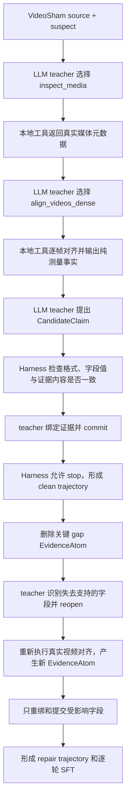

# 正式 API 启动前说明与检查报告

## 一句话说明

我们不是让大模型“看一眼视频后直接写答案”，而是把一对已有视频放进可执行工具环境，让 LLM teacher 像调查员一样逐步调用工具、读取真实测量、建立 claim、引用证据并决定何时停止；然后故意删掉一条关键证据，要求它重新测量并只修复受影响的字段。最终把这些正确的“思考 + 工具调用”轮次编译成 SFT 数据。

当前结论：**适合启动 1 个真实 API pilot；还不适合直接批量生成整个数据集。** 单例必须先通过真实 teacher、自动验证和人工快速抽查，再扩展。

## 用的什么数据集

当前第一版只使用 Adobe Research 的 **VideoSham** 数据集中的 case `1004`：

| 内容 | 实际数据 |
|---|---|
| source | `1004_unedited.mp4`，125.692 秒，3765 帧，约 29.97 FPS |
| suspect | `1004_processed.mp4`，8.000 秒，192 帧，24 FPS |
| source ID | `vimeo-26432864` |
| 给定比较范围 | source 的 `1.0–12.0s` |
| 隐藏标注 | 数据集原始编辑说明与 `frame_dropping` 标签，只用于最后评分 |

学生/teacher 可见：两段视频、它们的中性 ID、比较范围、公开 ClaimSchema 和 ToolRegistry。

学生/teacher 不可见：编辑任务原文、oracle label、正确 claim 数值和 mutation 的目标字段答案。

这个数据集受 Adobe Research 许可证约束，当前材料应按非商业研究/教学用途处理。

## 怎么自动构造



case 1004 的真实对齐结果是：suspect 的 192 帧严格单调匹配到 source 约 `2.369–10.377s`；比较范围两端约 `1.000–2.369s` 和 `10.377–12.000s` 没有出现在 suspect 中，总计约 `2.992s`。

重要的是，对齐工具现在只返回这些**测量事实**，不再直接返回 `frame_dropping`、`selective_temporal_omission` 或 `source_to_edited` 等语义答案。语义结论必须由 teacher 根据公开 ontology 和测量结果提出。

## 构造什么格式

### 1. 原始 episode JSON：用于审计和复现

保存完整多轮过程：system、user、assistant reasoning、tool call、真实 tool observation、Harness 事件、最终 state 和 API response ID。

```json
{
  "turn_idx": 2,
  "reasoning": "元数据只能说明两段视频的范围和时长，还不能定位缺失内容，因此下一步需要执行稠密时间轴对齐。",
  "tool_name": "align_videos_dense",
  "params": {
    "source_ref": "source",
    "suspect_ref": "suspect",
    "comparison_scope_s": [1.0, 12.0]
  },
  "observation": {
    "status": "executed",
    "created_evidence_ids": ["EA-ALIGN-001", "EA-GAP-001"]
  }
}
```

### 2. 逐轮 SFT JSONL：真正用于训练

模仿 Harness-1：一条长轨迹拆成多条 datum。每条 datum 把前面的 action/observation 当上下文，只监督最后一个 assistant 的“自然语言 reasoning + tool call”，不把当前 tool observation 放进 target。

```json
{
  "messages": [
    {"role": "system", "content": "..."},
    {"role": "user", "content": "..."},
    {"role": "assistant", "content": "...", "tool_calls": ["..."]},
    {"role": "tool", "content": "..."},
    {"role": "assistant", "content": "下一步理由...", "tool_calls": ["当前监督目标"]}
  ],
  "metadata": {
    "loss_scope": "last_assistant_action_only",
    "target_includes_observation": false,
    "target_execution_status": "executed"
  }
}
```

如果 teacher 某一步被 Harness 拒绝：该错误动作会保留在后续上下文中，让模型能够展示如何恢复；但是这一错误动作本身不会被导出为 SFT 正样本。

### 3. Full trajectory JSONL：仅用于回放

完整对话另外保存，但明确标成 `training_eligible=false`、`loss_roles=[]`，避免误把被拒绝的动作当成训练目标。

## 构造这些轨迹的目的

目标不是训练一个新的视觉 detector，也不是训练模型背诵 `frame_dropping` 标签，而是训练一个类似 Harness-1 的**工具策略模型**：

1. 根据当前公开状态判断还缺什么信息；
2. 选择正确工具和参数；
3. 根据真实 observation 更新 claim；
4. 给每个 claim 字段绑定可追溯证据；
5. 证据失效时只撤回依赖它的字段；
6. 重新执行工具获得新证据后局部修复；
7. 只有 obligation 全部关闭时才停止。

论文层面的主张仍应保持聚焦：**核心创新是 evidence-side intervention + suffix repair supervision，而不是工具数量或视频对齐算法本身。**

## 本次启动前优化

1. **移除答案式工具输出**：视频工具只输出对齐、覆盖、缺失区间和相似度等测量，不直接写语义标签。
2. **增加数值语义校验**：证据类型正确还不够；claim 的 source ID、范围、保留区间、遗漏区间和删除时长必须与所绑定 EvidenceAtom 的内容一致。
3. **公开 ontology、隐藏正确选项**：teacher 能看到合法字段取值和定义，但看不到该 case 的 oracle 选择。
4. **过滤错误 SFT target**：rejected/partially accepted action 不作为正监督；其后的正确恢复动作可以保留。
5. **API 多轮 reasoning 连续**：`store=false`，但加密 reasoning item 会随 function call 一起回传到下一轮，不会把每轮当成独立补全。
6. **有限重试**：对 408、429 和部分 5xx/连接超时进行最多 3 次短退避重试；认证、参数等确定性错误不重试。
7. **记录成本信号**：输出汇总 `input_tokens`、`output_tokens` 和 `total_tokens`，便于 pilot 后估算批量成本。
8. **正式产物一致性**：提升真实轨迹时同时更新 episode、逐轮 SFT、full replay、execution summary 和 validation report，不再残留旧报告。
9. **API key 隔离**：key 通过隐藏输入或环境变量临时进入进程，不写入源码、轨迹或日志。

## 验证结果

- 32 项自动测试全部通过。
- 离线真实视频流程重新执行成功。
- dense alignment 在 clean 和 repair 中分别执行一次，execution ID 不同。
- 离线 validation 全部通过；Rubric 为 `100/100`。
- 已加入反例测试：伪造不存在的 EvidenceAtom、使用类型正确但数值错误的证据、复用已删除证据、全局重置字段、提前 stop、oracle 文本泄漏和把 rejected action 当 SFT target 都不能通过。

## 仍然存在的边界

1. **当前只是一个正例 pilot**：只有 VideoSham case 1004，不能据此证明跨数据集泛化。
2. **当前是 paired-compare，不是 deep source search**：source 已给定，比较范围也由数据集提供；尚未验证在大规模 corpus 中搜索 source 的能力。
3. **当前 ClaimSchema 只覆盖时间遗漏**：还没有覆盖拼接、重排、速度变化、音画错配、OCR/ASR 事实检索等完整工具树。
4. **视觉对齐适合本例的近重复视频**：对大幅裁剪、覆盖字幕、重编码、镜像、视角变化或语义相似但非逐帧相同的视频，需要更强的分层 retrieval/alignment 工具。
5. **首次真实 teacher 仍可能走弯路**：系统会保留并过滤错误动作，但如果在最大轮数内没有合法 stop，该 episode 会被拒收。

因此，下一步应只运行 **1 条真实 GPT-5.4 clean+repair pilot**，检查 `llm_teacher_validation_report.json` 和实际自然语言 reasoning；通过后再做 10–20 条小批量，而不是立即全量生成。
