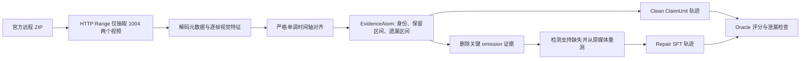

# VideoSham 1004：自动化 omission 轨迹最小闭环

> **2026-08-24 状态更正：** 早期文档中的“Rubric 100 分”和 6-case/12-trajectory 结果只能证明旧控制面下的执行一致性，不能证明策略真正使用了视频证据。最新致命证伪发现 272 个状态中 226 个预暴露目标调用、规则修复可无证据完成 3/3、无提示异常发现为 0/10，并出现 donor 结论复制。当前停止基于这些旧结论扩训；新的统一生产标准、八类因果探针和降控制生成流程见 [`RUBRIC_V7_CAUSAL_PACKET_AND_GENERATION.md`](RUBRIC_V7_CAUSAL_PACKET_AND_GENERATION.md)，完整查新见 [`allinone.md`](allinone.md)，证伪报告见 [`CLAIMUNITTEST_FATAL_FALSIFICATION_REVIEW_20260823.md`](CLAIMUNITTEST_FATAL_FALSIFICATION_REVIEW_20260823.md)。

这是一个已经跑通的单例：从 Adobe 官方 VideoSham 数据集中只抽取 case `1004` 的原视频与编辑视频，自动完成媒体解析、视觉时间轴对齐、ClaimUnit 构造、evidence dropout、修复轨迹生成和无泄漏验证。

正式调用 LLM teacher 前的通俗数据说明、构造格式、优化项和剩余限制见 [`PREFLIGHT_REVIEW.md`](PREFLIGHT_REVIEW.md)。

2026-08-18 的 VideoSham、VCSL 与 VidDiffBench 定向 10-case CLI canary、工具效用结论和数据集阻塞原因见 [`DATASET_CANARY_REPORT_20260818.md`](DATASET_CANARY_REPORT_20260818.md)。

统一多数据集 rubric、真实工具轨迹流程、VCSL 自动路由和 2026-08-20 的严格 canary 结果见 [`UNIFIED_TRAJECTORY_RUBRIC_AND_GENERATION.md`](UNIFIED_TRAJECTORY_RUBRIC_AND_GENERATION.md)。

2026-08-21 的当前生产 SFT 为 `outputs/production_sft_v7_external_contract`：每行包含与当前 `eligible_tools` 精确一致的原生函数 schema，target 使用模型可见的外部参数而非 harness 内部参数。UTQR-4 设计、600/600 Schema 校验和 student 生成 canary 见 [`RUBRIC_V4_TOOL_CONTRACT_AND_CANARY.md`](RUBRIC_V4_TOOL_CONTRACT_AND_CANARY.md)。最新的公开状态 affordance、真实状态动作执行与 v6 定向修复结果见 [`V6_EXECUTABLE_AFFORDANCE_RESULTS.md`](V6_EXECUTABLE_AFFORDANCE_RESULTS.md)。

最新闭环结果：除原有三数据集 clean/repair 面板外，又加入 VideoSham spatial、VCSL DP、两类 decision-reopen 和 VidDiff conflict clean/repair。最终 v10 + 原生状态约束的扩展面板 6/6 合法终止、0 个 rejected/partial action，严格 target-hidden Rubric 为 6/6 个 100 分。原面板与扩展面板合计 12 条已接受自由轨迹、66 个 student 动作。

最新批量自由闭环结果、teacher-free external holdout、SFT 历史泄漏修复、多样性平衡视图和真实量产边界见 [`STUDENT_CLOSED_LOOP_BATCH_RESULTS.md`](STUDENT_CLOSED_LOOP_BATCH_RESULTS.md)。当前新增证据为 25/25 条 accepted free-run、146 个真实 student 动作和 146 条完整校验 SFT；其中 VideoSham 新增 13 个从未进入 V6 任一划分的案例。

修复现在区分两种结构：证据丢失修复执行 reopen、必要测量、一次完整绑定、重新提交和 stop；证据仍有效但决定未提交时只需 commit、stop 两步。状态 Harness 仅在动作当前可执行时展示绑定方案，并把唯一完整参数编译进原生 tool schema；600 行中 103 个绑定状态和 162 个决定状态采用该约束。原先 7 个失败点 + 6 个外部哨兵的回归达到 13/13 精确，7/7 状态动作真实回放通过。

## 实际发现

- 数据集给出的中性比较窗口：源视频 `1.00–12.00s`。
- 编辑视频时长：`8.00s`。
- 192 个编辑帧与源视频严格单调对齐，平均与 5% 分位视觉相似度均为 `1.0`。
- 编辑视频实际保留源视频约 `2.369–10.377s` 的连续片段。
- 被省略的是窗口的两个边界：约 `1.000–2.369s` 与 `10.377–12.000s`，合计约 `2.992s`。
- 因此，本例应标成 `selective_temporal_omission`，实现方式是边界 `frame_dropping`；没有伪造“内部随机跳帧”。

## 自动流程



这里的关键设计是：数据集编辑任务文本和 manipulation label 只存在于 `oracle/`；学生可见输入只包含两段媒体、标识符和比较窗口。最终操作类型与遗漏区间必须从实际对齐证据中恢复。

## 可执行多轮 Harness 第一版

`src/interactive_harness.py` 在原有确定性分析旁边增加了真正的多轮环境。它不是把既有结果改写成步骤，而是依次执行：

```text
inspect_media
→ align_videos_dense
→ create_candidate_claim
→ bind_evidence
→ set_field_decision(committed)
→ stop
```

每一轮都保存自然语言 `reasoning`、标准的 `assistant.tool_calls` 和对应的 `tool` observation。reasoning 按 Harness-1 的接口说明本轮学到了什么、还缺什么证据、为什么选择当前工具；外部视频工具只能生成 Observation/EvidenceAtom；claim 值由 policy 提出；binding 由 Harness 校验；evidence coverage 由 Harness 重算；stop 只在所有高优先级 obligation 关闭后通过。

原始 episode 同时保存 Harness-1 风格的 `turn_history = {reasoning, tool_name, params, observation}`。训练 JSONL 不是“一条长对话只算一次 loss”，而是每个 action turn 展开为一个 datum：前序 reasoning/action/observation 和 Harness state 作为 context，最后一条 assistant reasoning + tool call 是唯一监督目标。

Repair episode 从 clean final snapshot 恢复，删除 `EA-GAP-001`，但不改媒体、claim value 或 assistant 文本。删除后，只有依赖它的五个字段失去支持。策略从字段状态自行识别并重开这些字段，再次真实执行 `align_videos_dense`，获得新的 `EA-GAP-002` 后局部重绑；`source_id`、`comparison_scope_s` 和 `retained_source_interval_s` 全程保持不变。student-visible mutation 不直接给出 target/invariant field 答案。

## 一键运行

首次准备（会下载约 24MB 视频和约 31MB PyAV wheel，而不是两个 1.3GB+ 完整 ZIP）：

```powershell
powershell -ExecutionPolicy Bypass -File .\prepare_case.ps1
```

数据与依赖已存在时：

```powershell
powershell -ExecutionPolicy Bypass -File .\run.ps1
```

测试：

```powershell
$env:PYTHONPATH = (Resolve-Path .\vendor).Path
python -m unittest discover -s .\tests -v
```

### 真实 LLM teacher rollout

`src/llm_teacher_rollout.py` 已把固定动作模板替换为真正的 OpenAI Responses API agent loop。默认 teacher 是 `gpt-5.4`，与 Harness-1 公布的 teacher 设置对齐；每轮强制调用且只调用一个工具，并要求在工具参数中提供自然语言 reasoning。模型只负责选择下一步动作和提出 claim/binding/decision，媒体 observation 与 EvidenceAtom 必须由本地可执行工具产生。

API 返回的 reasoning item 与 function call 会原样带入下一轮，工具执行结果则通过 `function_call_output` 回传，因此多轮推理不是互相独立的单次补全。完整 clean rollout 后，环境自动删除关键 evidence，再启动一个 repair rollout；repair 必须重新运行视频对齐并局部恢复支持，才允许 stop。

运行脚本后按提示输入 key（输入内容隐藏，并且只在该进程内临时存在）：

```powershell
powershell -ExecutionPolicy Bypass -File .\run_llm_teacher.ps1
```

如果当前会话已经有 `OPENAI_API_KEY`，脚本会直接使用它。不要把 key 写入仓库、JSONL 或配置文件。如需换模型，可先设置 `$env:CLAIMUNIT_TEACHER_MODEL`。实时轨迹先写入 `outputs/llm_teacher_*`；只有全套验证通过后，脚本才会将它提升为正式的 `outputs/interactive_*` SFT 产物。

### 先用 Codex CLI 跑单例

在投入 API key 批量生成前，可以使用项目隔离安装的官方 Codex CLI 作为 teacher transport。CLI teacher 仍然每轮只选择一个 Harness action；视频工具、EvidenceAtom、状态机、SFT 编译和验证与 API backend 完全相同。区别只是动作选择通过已登录 CLI 的结构化输出完成。

首次执行一次设备登录：

```powershell
$node = 'C:\Users\Zya\.cache\codex-runtimes\codex-primary-runtime\dependencies\node\bin\node.exe'
& $node .\tools\codex_cli\node_modules\@openai\codex\bin\codex.js login --device-auth
```

然后运行 case 1004：

```powershell
powershell -ExecutionPolicy Bypass -File .\run_cli_teacher.ps1
```

正式接收前还会执行 `STEP-UTILITY-CAUSAL-REPLAY-V1`：逐步删除 action 并回放固定 suffix；外部工具步骤还会删除其 observation/evidence。只有删除后无法得到同样合法结果、reasoning 与当时可见状态一致、且输出被下游消费的步骤才进入逐轮 SFT。

## 产物

- `oracle/claim_oracle.json`：隐藏标签，仅用于最终评分。
- `student_view/case_manifest.json`：学生可见输入边界。
- `student_view/evidence_atoms.jsonl`：四个可追溯证据原子（媒体、比较窗口、视觉对齐、遗漏测量）。
- `student_view/alignment_summary.json`：192 帧的对齐诊断。
- `outputs/clean_trajectory.json`：完整正确轨迹。
- `outputs/mutated_state.json`：删除关键 omission 证据后的状态。
- `outputs/repair_trajectory.json`：识别证据缺口并重测后的修复轨迹。
- `outputs/sft_clean.jsonl` 与 `outputs/sft_repair.jsonl`：可直接进入后续转换器的 SFT 样本。
- `outputs/validation_report.json`：标签匹配、窗口匹配、证据引用、对齐质量、dropout/repair 和泄漏检查。
- `outputs/trajectory_quality_report.json`：论文启发的 6 个 hard checks 与 100 分轨迹质量评分。
- `outputs/provenance_graph.json`：action—evidence—field—obligation—claim—stop 溯源图。
- `outputs/interactive_clean_episode.json`：15-message、6 次可执行调用的 clean 多轮环境记录。
- `outputs/interactive_repair_episode.json`：从证据失效到重新对齐和局部修复的后缀回放。
- `outputs/interactive_sft_clean.jsonl` 与 `outputs/interactive_sft_repair.jsonl`：Harness-1 风格的逐轮训练 datum，分别为 6 条和 5 条；每条只监督最后一个 assistant reasoning + tool call。
- `outputs/interactive_sft_*_full_trajectory.jsonl`：保留完整多轮对话，供回放和调试。
- `outputs/interactive_execution_summary.json`：外部工具实际执行次数与 clean/repair execution ID。
- `outputs/interactive_validation_report.json`：重执行、字段 sensitivity、off-target invariance、stop 与无泄漏检查。
- `outputs/llm_teacher_clean_episode.json` 与 `outputs/llm_teacher_repair_episode.json`：真实 API teacher 选择动作、本地环境执行 observation 的原始多轮记录。
- `outputs/llm_teacher_sft_clean.jsonl` 与 `outputs/llm_teacher_sft_repair.jsonl`：由真实 teacher rollout 展开的逐轮 SFT datum。
- `outputs/llm_teacher_validation_report.json`：真实 response ID、重新执行、局部修复、oracle 后验评分和无泄漏检查。
- `outputs/llm_teacher_step_utility_report.json`：逐步 action 删除、observation dropout、reasoning grounding 和 SFT eligibility 报告。
- `rubric/trajectory_quality_rubric.json`：机器可读 ECSO 轨迹 Rubric。
- `RUBRIC_DESIGN.md`：文献依据、评分解释、反例元评测与人类校准方案。

## 数据来源与限制

数据来自 [Adobe Research VideoSham](https://github.com/adobe-research/VideoSham-dataset)，原 Vimeo ID 为 `26432864`。VideoSham 仅允许非商业研究与教学用途，详见本目录的 `AdobeResearchLicensev1.1a.txt`。若扩展为大规模训练集，应保留每个视频的原始署名与许可证信息。

仓库保留确定性 rollout 作为离线回归测试，但正式 SFT 可由 `run_llm_teacher.ps1` 调用真实 teacher 重新生成，因此会产生相应 API 费用。当前代码刻意只验证“单例闭环”；要扩到整个数据集，下一步应把比较窗口解析、case 筛选和失败分流批量化，并把无可靠对齐的样本降为低置信度或拒收。
